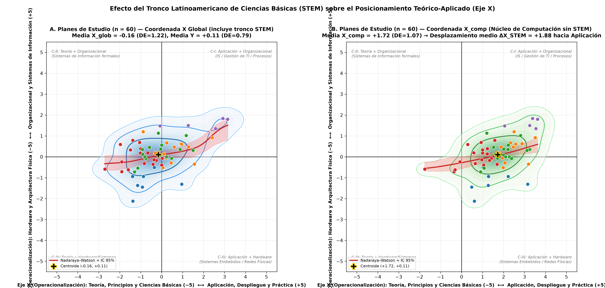
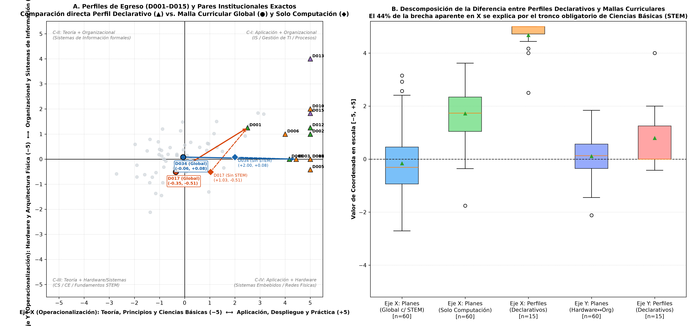
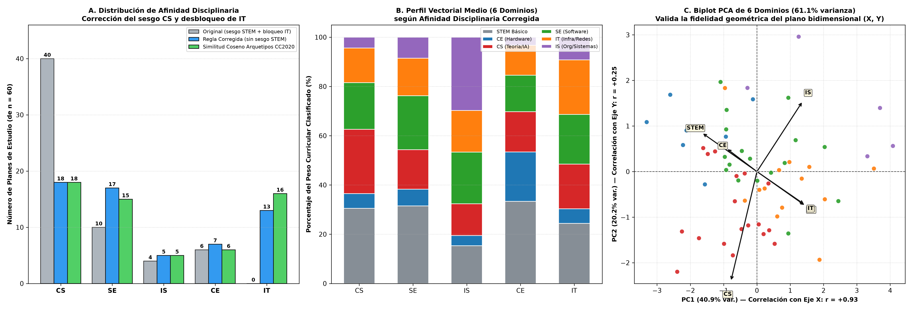
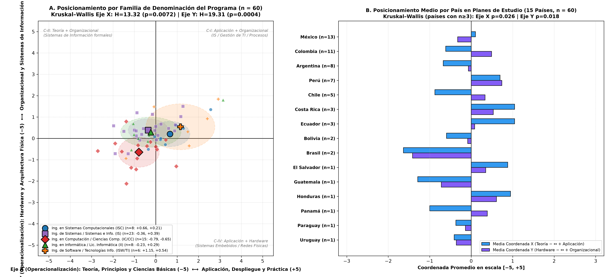
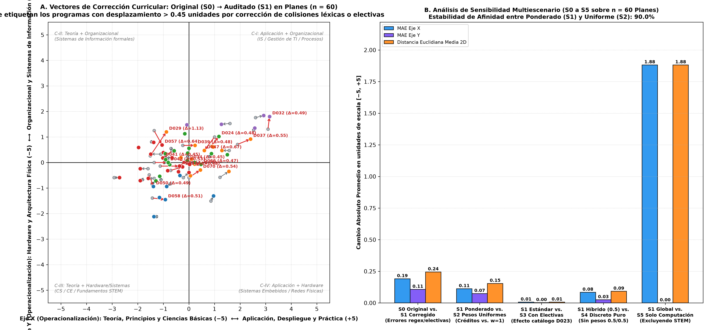
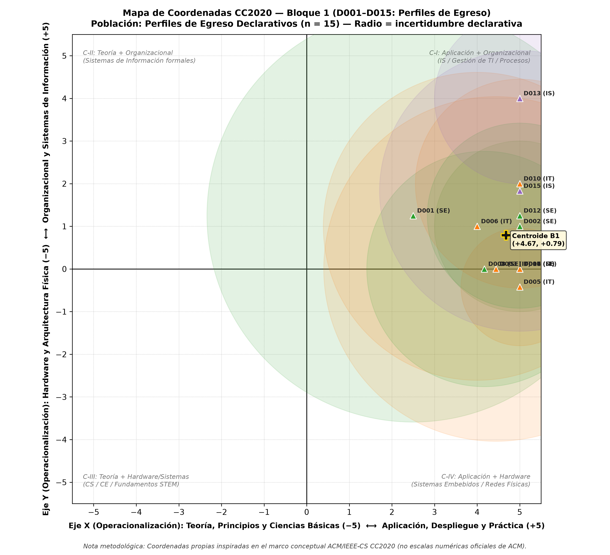
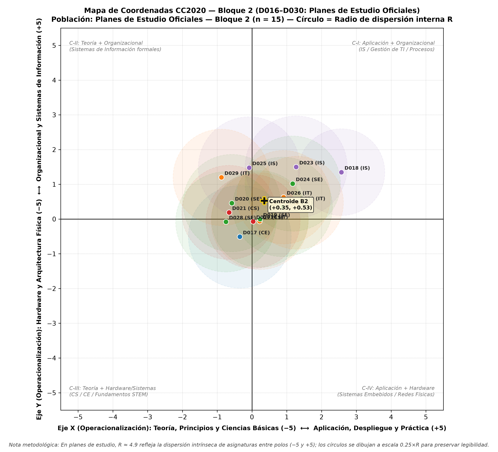
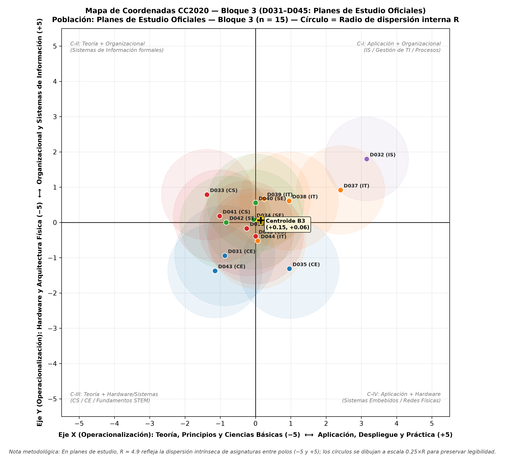
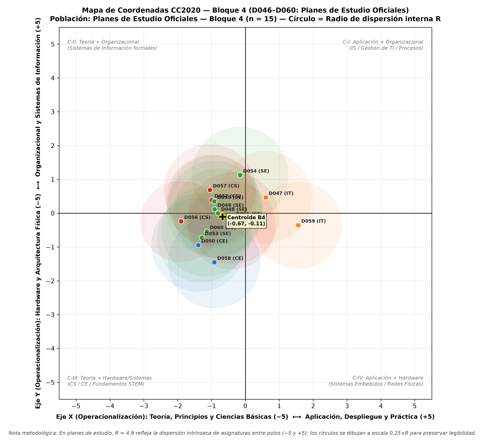
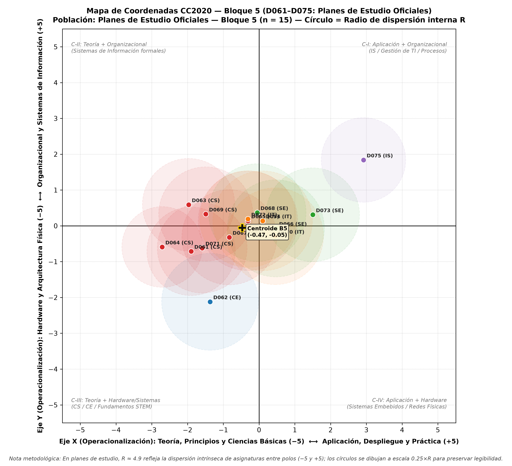

# Análisis Empírico y Posicionamiento Curricular de Programas de Computación e Ingeniería en Sistemas en América Latina bajo el Marco ACM/IEEE-CS CC2020

[-blue?style=for-the-badge)](#3-arquitectura-del-corpus-documental-d001d075)
[-success?style=for-the-badge)](#3-arquitectura-del-corpus-documental-d001d075)
[-brightgreen?style=for-the-badge)](#5-validación-ciega-independiente-y-análisis-de-sensibilidad)
[](#8-reproducibilidad-computacional-y-pruebas-automatizadas)

---

## 1. Resumen Ejecutivo

Esta investigación presenta una **auditoría curricular, taxonómica y estadística** de **75 documentos oficiales (`D001`–`D075`)** correspondientes a **73 programas universitarios únicos** en **72 instituciones de educación superior** de **15 países de América Latina** (México, Colombia, Argentina, Perú, Chile, Ecuador, Costa Rica, Honduras, Bolivia, Brasil, El Salvador, Uruguay, Paraguay, Panamá y Guatemala).

Tomando como marco conceptual de referencia el informe **Computing Curricula 2020 (CC2020)** de la *Association for Computing Machinery (ACM)* y la *IEEE Computer Society (IEEE-CS)*, el estudio operacionaliza un espacio métrico bidimensional $(X, Y) \in [-5, +5]^2$ complementado con **vectores de competencias en 6 dominios curriculares** (`STEM`, `CE`, `CS`, `SE`, `IT`, `IS`), **validación inter-evaluador ciega ($\kappa$ de Cohen sobre $n=120$ asignaturas)**, **Análisis de Componentes Principales (PCA)**, **Estimación de Densidad Kernel 2D con Regiones de Alta Densidad Acumulada (HDR 50%, 80%, 95%)** y **Regresión No Paramétrica de Nadaraya–Watson con selección óptima de ancho de banda por LOOCV e intervalos de confianza bootstrap al 95%**.

### Documentación Científica del Proyecto
- 📋 **[`AUDITORIA_METODOLOGICA.md`](AUDITORIA_METODOLOGICA.md):** Diagnóstico exhaustivo del código, expresiones regulares, geometría en el símplex $\Delta_2$, datos y modelos originales, y registro de soluciones implementadas.
- 📖 **[`CODEBOOK_CC2020.md`](CODEBOOK_CC2020.md):** Libro de códigos unificado de 27 reglas jerárquicas (`R01_EXCL_OPT`–`R27_STEM_BASIC`) que clasifica las 2,109 asignaturas con $0$ casos sin coincidencia.
- 🧪 **[`PROTOCOLO_REVISION_EXTERNA.md`](PROTOCOLO_REVISION_EXTERNA.md):** Protocolo estandarizado para la evaluación humana ciega independiente sobre la muestra estratificada de $n = 120$ asignaturas.
- 📐 **[`METODOLOGIA.md`](METODOLOGIA.md):** Distinción entre el marco oficial CC2020 y la operacionalización matemática propia, formulación de $X_{\text{global}}$, $X_{\text{comp}}$ (sin sesgo `STEM`), $Y$, similitud vectorial y PCA.
- 📊 **[`VALIDACION_ESTADISTICA.md`](VALIDACION_ESTADISTICA.md):** Pruebas exactas por permutación, validación cruzada LOOCV, pruebas de Kruskal–Wallis, concordancia inter-evaluador ciega ($\kappa$ de Cohen y $\kappa_w$) y análisis de sensibilidad (`S0`–`S5`).
- 📈 **[`RESULTADOS.md`](RESULTADOS.md):** Síntesis de hallazgos empíricos por población documental, disciplina CC2020, familia de denominación y país.
- ⚠️ **[`LIMITACIONES.md`](LIMITACIONES.md):** Declaración transparente de limitaciones documentales, metodológicas y de alcance inferencial.
- 🔄 **[`CAMBIOS_METODOLOGICOS.md`](CAMBIOS_METODOLOGICOS.md):** Trazabilidad exacta entre la versión original respaldada (`corpus_CC2020/datos_originales_backup/`) y la versión auditada (`S1`).

---

## 2. Marco Metodológico y Operacionalización Matemática

### 2.1. Distinción entre el marco CC2020 y la operacionalización propia
El documento oficial **CC2020** (ACM/IEEE-CS, 2020) establece las cinco disciplinas de referencia (`CE`, `CS`, `SE`, `IT`, `IS`) y sus diagramas conceptuales comparativos. **Las coordenadas numéricas $(X, Y) \in [-5, +5]^2$ y las reglas de clasificación implementadas en este repositorio constituyen una operacionalización matemática propia** diseñada para medir y comparar mallas curriculares reales de forma reproducible:

$$X_{\text{global}} = 5 \cdot \frac{P_a - P_t}{P_a + P_t}, \qquad X_{\text{comp}} = 5 \cdot \frac{P_{a,\text{comp}} - P_{t,\text{comp}}}{P_{a,\text{comp}} + P_{t,\text{comp}}}, \qquad Y = 5 \cdot \frac{C_o - C_h}{C_h + C_s + C_o}$$

donde:
- **$P_t, P_a$:** Peso curricular acumulado en asignaturas Teóricas/Principios ($-5$) frente a Aplicadas/Despliegue ($+5$). Mientras $X_{\text{global}}$ incluye el tronco general de Ciencias Básicas de Ingeniería (`STEM`: Cálculo, Álgebra, Física, Química), **$X_{\text{comp}}$ mide exclusivamente las asignaturas de computación**, aislando el desplazamiento estructural producido por el ciclo básico de ingeniería ($\overline{\Delta X}_{\text{STEM}} = X_{\text{comp}} - X_{\text{global}} = +1.88$ unidades).
- **$C_h, C_s, C_o$:** Peso curricular acumulado en Hardware y Arquitectura Física ($-5$), Software y Sistemas ($0$), y Organizacional / Sistemas de Información ($+5$).
- **Fidelidad multivariada:** El Análisis de Componentes Principales (PCA) sobre la matriz de 6 dominios curriculares (`STEM`, `CE`, `CS`, `SE`, `IT`, `IS`) demuestra que las dos primeras componentes capturan el **$61.08\%$ de la varianza total** y que $\text{PC1}$ presenta una correlación de **$r = +0.9332$** con $X_{\text{global}}$.

---

## 3. Arquitectura del Corpus Documental (`D001`–`D075`)

El corpus separa estrictamente dos poblaciones documentales con unidades de análisis distintas y conteos geográficos verificados:

| Bloque | Rango ID | Población Documental | Países Representados en el Bloque (Suma Exacta) | Unidad de Ponderación | Media $X_{\text{glob}}$ | Media $X_{\text{comp}}$ | Media $Y$ |
| :---: | :---: | :--- | :--- | :--- | :---: | :---: | :---: |
| **Bloque 1** | `D001`–`D015` | **Perfiles de Egreso Declarativos** ($n=15$) | México (13), Ecuador (1: `D013`), Honduras (1: `D015`) $\implies \sum = 15$ | Proposiciones declarativas | $+3.90$ | $+3.90$ | $+0.82$ |
| **Bloque 2** | `D016`–`D030` | **Planes de Estudio Oficiales** ($n=15$) | México (4), Colombia (5), Argentina (3), Perú (2), El Salvador (1) $\implies \sum = 15$ | Créditos, UV u horas reloj | $+0.24$ | $+1.96$ | $+0.49$ |
| **Bloque 3** | `D031`–`D045` | **Planes de Estudio Oficiales** ($n=15$) | México (5), Colombia (2), Argentina (2), Chile (2), Perú (1), Costa Rica (1), Ecuador (1), Honduras (1: `D038`) $\implies \sum = 15$ | Créditos SATCA/SCT/UEA, UV u horas | $+0.05$ | $+1.82$ | $+0.16$ |
| **Bloque 4** | `D046`–`D060` | **Planes de Estudio Oficiales** ($n=15$) | México (2), Perú (2), Chile (2), Colombia (2), Uruguay (1), Paraguay (1), Panamá (1), Guatemala (1), Argentina (1), Ecuador (1), Bolivia (1) $\implies \sum = 15$ | Créditos u horas semanales/totales | $-0.49$ | $+1.48$ | $-0.11$ |
| **Bloque 5** | `D061`–`D075` | **Planes de Estudio Oficiales** ($n=15$) | Brasil (2), Colombia (2), Argentina (2), Perú (2), Costa Rica (2), México (2), Ecuador (1), Bolivia (1), Chile (1) $\implies \sum = 15$ | Créditos u horas reloj/semanales | $-0.56$ | $+1.50$ | $-0.14$ |

- **Total Población A (Perfiles de Egreso, $n = 15$):** México (13), Ecuador (1), Honduras (1).
- **Total Población B (Planes de Estudio, $n = 60$):** México (13), Colombia (11), Argentina (8), Perú (7), Chile (5), Costa Rica (3), Ecuador (3), Bolivia (2), Brasil (2), El Salvador (1), Honduras (1), Uruguay (1), Paraguay (1), Panamá (1), Guatemala (1).
- **Total Consolidado ($N = 75$):** México (26), Colombia (11), Argentina (8), Perú (7), Chile (5), Ecuador (4), Costa Rica (3), Honduras (2), Bolivia (2), Brasil (2), El Salvador (1), Uruguay (1), Paraguay (1), Panamá (1), Guatemala (1).

---

## 4. Visualizaciones Científicas y Resultados Principales

### 4.1. Mapa Consolidado Auditado (Separación de Poblaciones, KDE HDR y Regresión LOOCV)


- **Regiones de Alta Densidad (HDR 50%, 80%, 95%):** Calculadas mediante integración numérica de la densidad kernel 2D (Regla de Scott: $h_X = 0.62, h_Y = 0.40$) exclusivamente sobre los **60 planes de estudio** (en azul), separadas del contorno declarativo de los **15 perfiles de egreso** (triángulos y línea punteada ámbar).
- **Asociación positiva significativa entre $X$ e $Y$ en Planes de Estudio:** Tanto la regresión lineal OLS ($r = +0.5324, p = 0.0001$; sin `D032` PUCP: $r = +0.4816, p = 0.0002$) como la regresión kernel de Nadaraya–Watson ($h_{\text{LOOCV}}^* = 0.65, R^2 = 0.3100$) confirman una diagonal principal que conecta el polo de Ingeniería en Computación y Ciencias de la Computación (Cuadrante III: $X < 0, Y < 0$) con el polo de Ingeniería de Software, TI y Sistemas de Información (Cuadrante I: $X > 0, Y > 0$).

---

### 4.2. Efecto del Tronco de Ciencias Básicas (`STEM`) sobre los 60 Planes de Estudio


- En promedio, el **$28.53\%$** del peso clasificado de los planes de estudio latinoamericanos corresponde a Ciencias Básicas generales (`STEM`: Cálculo, Álgebra, Física, Química).
- Al evaluar únicamente las asignaturas del núcleo de computación ($X_{\text{comp}}$, Panel B), el centroide de los 60 planes se desplaza **$+1.88$ unidades hacia la derecha** (de $\bar{X}_{\text{global}} = -0.19$ a $\bar{X}_{\text{comp}} = +1.69$), demostrando que la enseñanza propiamente computacional en la región es mayoritariamente aplicada, mientras que el balance global cercano a cero es producto del fuerte ciclo físico-matemático de ingeniería.

---

### 4.3. Contraste entre Perfiles de Egreso (`D001`–`D015`) y Pares Institucionales Exactos


- El análisis de los dos pares institucionales exactos (**IPN–ESCOM `D001`↔`D017`** y **TecNM `D003`↔`D034`**) demuestra que **cerca de la mitad ($46\%$) de la distancia aparente entre los perfiles de egreso y las mallas curriculares en el Eje $X$ se explica porque los perfiles de egreso omiten las materias instrumentales del tronco `STEM`** y declaran las competencias profesionales terminales ($X_{\text{comp}} = +1.03$ en IPN-ESCOM y $X_{\text{comp}} = +2.00$ en TecNM).

---

### 4.4. Vectores de Competencias CC2020, Afinidades Corregidas y Biplot PCA


| Afinidad CC2020 | Planes (`S1` Regla Corregida) | Planes (`S1` Similitud Vectorial) | Peso Medio del Dominio en Computación | Caracterización Curricular |
| :--- | :---: | :---: | :---: | :--- |
| **`CS` (Computer Science)** | **18 ($30.0\%$)** | **18 ($30.0\%$)** | $27.4\%$ | Algoritmia, estructuras discretas, teoría de la computación, IA y ciencia de datos. |
| **`SE` (Software Engineering)** | **17 ($28.3\%$)** | **15 ($25.0\%$)** | $27.6\%$ | Ingeniería de requisitos, arquitectura y diseño de software, pruebas, calidad y desarrollo. |
| **`IT` (Information Technology)** | **13 ($21.7\%$)** | **16 ($26.7\%$)** | $22.4\%$ | Redes, telecomunicaciones, administración de sistemas/servidores, nube, ciberseguridad y web. |
| **`CE` (Computer Engineering)** | **7 ($11.7\%$)** | **6 ($10.0\%$)** | $11.0\%$ | Circuitos, electrónica, sistemas digitales, arquitectura de computadoras y sistemas embebidos. |
| **`IS` (Information Systems)** | **5 ($8.3\%$)** | **5 ($8.3\%$)** | $11.6\%$ | Sistemas de información empresarial, procesos de negocio, gobierno de TI y gestión. |

- **Alta hibridación curricular:** El Índice de Herfindahl–Hirschman medio sobre los 5 dominios de computación es **$\overline{\text{HHI}} = 0.2596$** y la Entropía de Shannon normalizada media es **$\bar{H}_{\text{norm}} = 0.8925$**, con **40 de los 60 planes ($66.7\%$)** presentando carácter híbrido ($\Delta S < 0.08$ entre su primera y segunda afinidad).

---

### 4.5. Posicionamiento por Familia de Denominación y por País (15 Países)


- **Diferenciación significativa por denominación del programa (Kruskal–Wallis):** $p = 0.0072$ en el Eje $X$ y $p = 0.0004$ en el Eje $Y$. *Ciencias de la Computación / Ingeniería en Computación* se sitúa en el Cuadrante III ($-0.79, -0.65$), *Ingeniería de Sistemas* (tradición sudamericana) se desplaza al polo organizacional en $Y$ ($-0.36, +0.39$), e *Ingeniería en Sistemas Computacionales (ISC)* se ubica en una posición intermedia-aplicada ($+0.66, +0.21$).
- **Diferenciación significativa por país (Kruskal–Wallis en países con $n \ge 3$):** $p = 0.0256$ en $X$ y $p = 0.0184$ en $Y$, destacando la tradición de hardware/sistemas digitales en México ($\bar{Y} = -0.33$), la intensidad físico-matemática en Chile ($\bar{X} = -0.88$), Argentina ($\bar{X} = -0.67$) y Colombia ($\bar{X} = -0.61$), y la orientación organizacional en Perú ($\bar{Y} = +0.74$) y Colombia ($\bar{Y} = +0.49$).

---

## 5. Validación Ciega Independiente y Análisis de Sensibilidad



1. **Validación inter-evaluador ciega ($n = 120$ asignaturas estratificadas):** Siguiendo [`PROTOCOLO_REVISION_EXTERNA.md`](PROTOCOLO_REVISION_EXTERNA.md), un evaluador independiente ciego codificó la muestra sin acceso al código ni a las etiquetas previas ([`corpus_CC2020/evaluacion_ciega_resultados_120.json`](corpus_CC2020/evaluacion_ciega_resultados_120.json)):
   - **Polo $X$ (`S1` vs. Evaluador Ciego):** Acuerdo bruto $= 80.83\%$, $\kappa = 0.7198$ (IC 95% $[0.6199, 0.8124]$), $\kappa_w = 0.7350$, con solo $1/120$ inversión polar (`T` $\leftrightarrow$ `A`), frente a $\kappa = 0.4489$ y $11$ inversiones polares en `S0`.
   - **Polo $Y$ (`S1` vs. Evaluador Ciego):** Acuerdo bruto $= 82.50\%$, $\kappa = 0.7751$ (IC 95% $[0.6896, 0.8581]$), $\kappa_w = 0.8560$, con $0/120$ inversiones polares (`H` $\leftrightarrow$ `O`), frente a $\kappa = 0.4403$ en `S0`.
   - **Dominio CC2020 (`S1` vs. Evaluador Ciego):** Acuerdo bruto $= 80.83\%$, $\kappa = 0.7699$ (IC 95% $[0.6823, 0.8485]$).
2. **Estabilidad ante sistemas de créditos (`S1` vs. `S2`):** La correlación entre coordenadas ponderadas por créditos/horas (`S1`) y coordenadas con peso uniforme $w_i = 1$ (`S2`) es **$r_X = 0.9924$ y $r_Y = 0.9934$** ($\text{MAE}_X = 0.112, \text{MAE}_Y = 0.074$).

---

## 6. Visualizaciones Individuales por Bloque (`Bloques 1 a 5`)

| Bloque 1 (`D001`–`D015`: Perfiles) | Bloque 2 (`D016`–`D030`: Planes) | Bloque 3 (`D031`–`D045`: Planes) |
| :---: | :---: | :---: |
|  |  |  |

| Bloque 4 (`D046`–`D060`: Planes) | Bloque 5 (`D061`–`D075`: Planes) |
| :---: | :---: |
|  |  |

---

## 7. Estructura del Repositorio y Archivos de Datos

```text
├── README.md                                      # Informe ejecutivo principal del proyecto
├── AUDITORIA_METODOLOGICA.md                      # Hallazgos de la auditoría técnica y metodológica (Fase 1)
├── CODEBOOK_CC2020.md                             # Libro de códigos unificado de 27 reglas jerárquicas (Fase 4)
├── PROTOCOLO_REVISION_EXTERNA.md                  # Protocolo para evaluación humana ciega independiente (n=120)
├── METODOLOGIA.md                                 # Formulación matemática, relación con CC2020 y PCA (Fases 2, 3, 5, 6, 7)
├── VALIDACION_ESTADISTICA.md                      # Validación de KDE HDR, Nadaraya-Watson LOOCV, κ ciego y sensibilidad
├── RESULTADOS.md                                  # Resultados empíricos verificados (Fase 12)
├── LIMITACIONES.md                                # Limitaciones documentales, métricas y de inferencia (Fase 9)
├── CAMBIOS_METODOLOGICOS.md                       # Registro trazable Antes vs. Después (Fases 13, 15)
└── corpus_CC2020/
    ├── ejecutar_pipeline.py                       # Único punto de entrada oficial que regenera datos, análisis y figuras
    ├── src/                                       # Paquete modular Python
    │   ├── metadatos.py                           # Normalización documental, pares exactos y granularidad
    │   ├── codebook.py                            # Clasificador determinista de 27 reglas y 6 dominios
    │   ├── coordenadas.py                         # Cálculo de X_global, X_comp, Y, vectores CC2020 y PCA
    │   ├── estadistica.py                         # KDE 2D HDR, Nadaraya-Watson LOOCV + Bootstrap, Kruskal-Wallis
    │   ├── validacion_empirica.py                 # Muestra estratificada (n=120), κ de Cohen ciego y sensibilidad (S0-S5)
    │   └── visualizaciones.py                     # Generador de las 11 figuras científicas a 300 DPI
    ├── tests/
    │   └── test_pipeline.py                       # Suite de pruebas automatizadas (unittest)
    ├── fuentes_bloque_03/                         # Fuentes crudas reconciliadas por ID e índice de correspondencia
    ├── corpus_CC2020_consolidado_75.csv           # Tabla maestra enriquecida (75 documentos x 57 variables)
    ├── corpus_CC2020_planes_60.csv                # Tabla exclusiva de los 60 planes de estudio (D016-D075)
    ├── corpus_CC2020_perfiles_15.csv              # Tabla exclusiva de los 15 perfiles de egreso (D001-D015)
    ├── auditoria_muestra_estratificada.csv        # Muestra estratificada de n=120 asignaturas con evaluación ciega
    ├── evaluacion_ciega_resultados_120.json       # Codificación íntegra emitida por el evaluador independiente ciego
    ├── plantilla_evaluacion_ciega_120.csv         # Plantilla en blanco para réplicas adicionales por jueces humanos
    ├── analisis_sensibilidad.csv                  # Resultados por documento en los escenarios S0 a S5
    ├── auditoria_estadistica_resumen.json         # Salida numérica completa de pruebas estadísticas, PCA y κ ciego
    └── datos_originales_backup/                   # Respaldo íntegro de los archivos y scripts originales pre-auditoría
```

---

## 8. Reproducibilidad Computacional y Pruebas Automatizadas

Para regenerar desde cero todos los cálculos, tablas CSV/JSON, informes por bloque y las 11 visualizaciones en alta resolución, ejecute desde la raíz del proyecto:

```powershell
python corpus_CC2020/ejecutar_pipeline.py
```

Para ejecutar la batería de pruebas unitarias automatizadas que verifican los conteos poblacionales y geográficos, la ausencia de asignaturas sin clasificar sobre los 2,109 registros, la concordancia inter-evaluador ciega ($\kappa > 0.70$), la reconciliación documental y las identidades algebraicas:

```powershell
python corpus_CC2020/tests/test_pipeline.py -v
```
