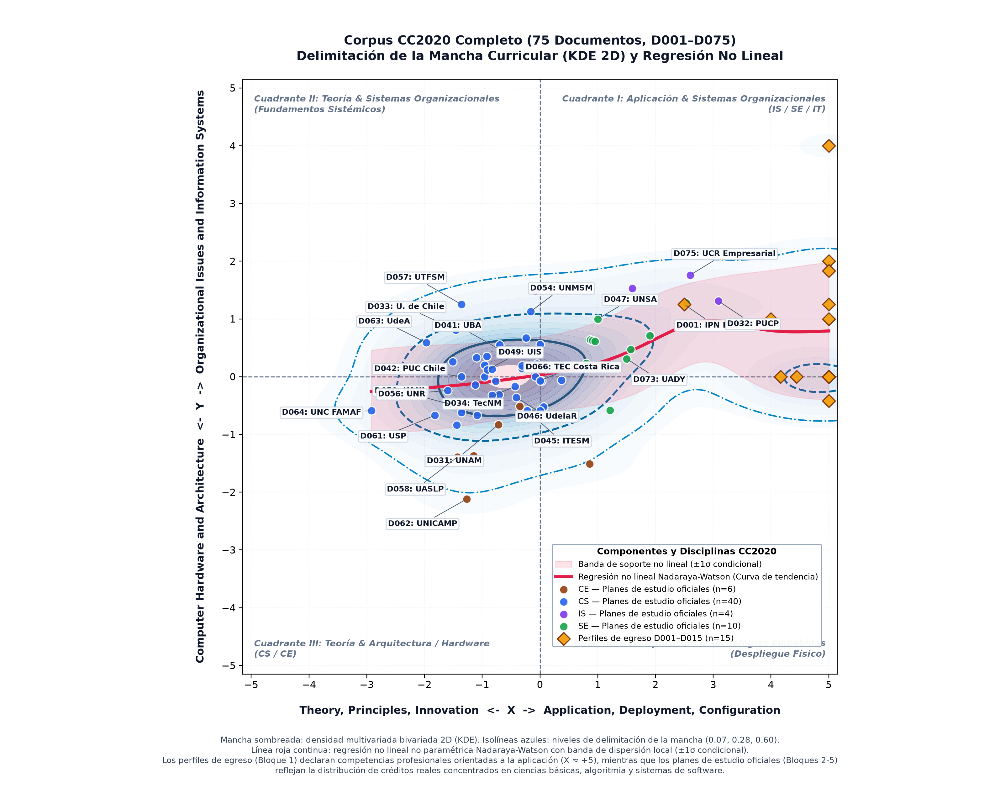
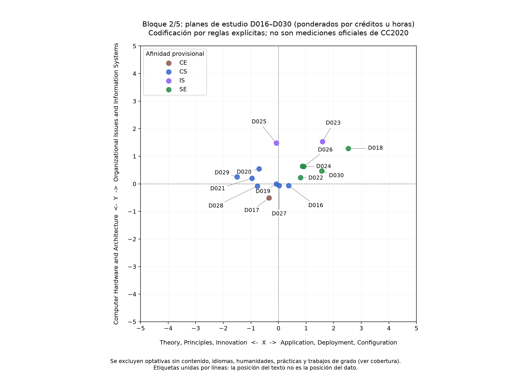
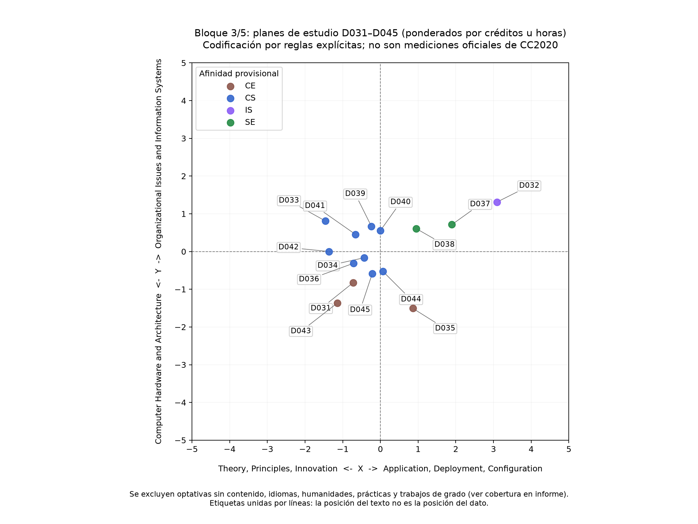
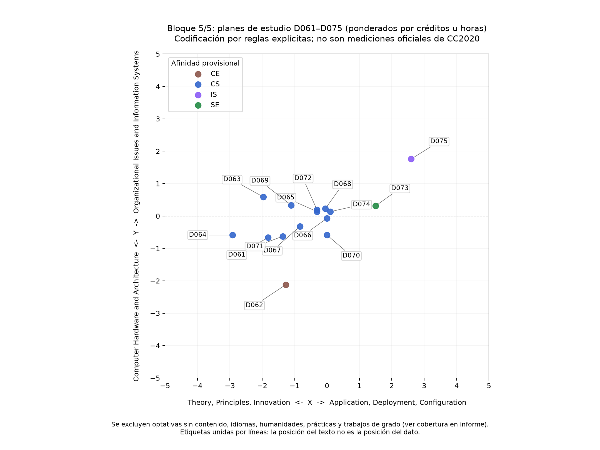

# Auditoría Curricular CC2020: Caracterización, Modelado y Conclusiones del Corpus de 75 Programas de Computación en América Latina


-blue.svg)


---

## 1. ¿De qué trata este proyecto de investigación?

Este proyecto constituye una **auditoría curricular comparativa y empírica** a gran escala sobre la formación universitaria en informática, ingeniería de sistemas y ciencias de la computación en América Latina.

A través del estándar internacional **ACM/IEEE CC2020 (*Computing Curricula 2020: Paradigms for Global Computing Education*)**, se analizan, transcriben y modelan matemáticamente **75 documentos oficiales (D001–D075)** que representan la oferta académica de universidades líderes de 8 países: **Argentina, Brasil, Chile, Colombia, Costa Rica, México, Perú y Uruguay**.

### 1.1 El Marco Canónico ACM/IEEE CC2020
El estándar CC2020 define el panorama de la computación no como etiquetas rígidas, sino como un **espacio bidimensional continuo $[-5, +5] \times [-5, +5]$**:

- **Eje X ($-5$ a $+5$) — Dimensión Epistemológica**:
  - **$-5$ (Theory, Principles, Innovation)**: Énfasis en fundamentos matemáticos, demostración formal, formulación algorítmica y métodos científicos.
  - **$+5$ (Application, Deployment, Configuration)**: Énfasis en implementación práctica, integración de tecnologías existentes, configuración en entornos productivos y uso aplicado.
- **Eje Y ($-5$ a $+5$) — Dimensión Tecnológica/Sistémica**:
  - **$-5$ (Computer Hardware and Architecture)**: Circuitos digitales, microarquitectura, dispositivos embebidos, física del silicio y diseño de hardware.
  - **$+5$ (Organizational Issues and Information Systems)**: Gestión de tecnologías, procesos de negocio, gobierno de TI, factores humanos, alineación estratégica y economía digital.
- **Punto Central $(0, 0)$**: Nivel de *Software Systems*, infraestructura intermedia, sistemas operativos y redes, con un balance simétrico entre teoría y aplicación.

```
                         [Y: +5] Organizational Issues & Information Systems
                                    ▲
                                    │   Cuadrante I: Aplicación Organizacional
    Cuadrante II: Teoría &          │   (Information Systems - IS / Software Eng - SE)
    Sistemas Organizacionales       │
                                    │
 [X: -5] ───────────────────────────┼───────────────────────────► [X: +5]
 Theory, Principles, Innovation     │ (0,0) Software Systems    Application, Deployment,
                                    │                           Configuration
    Cuadrante III: Teoría &         │   Cuadrante IV: Aplicación de Hardware
    Arquitectura / Hardware         │   (Tecnologías Embebidas y Despliegue Físico)
    (Computer Science - CS / CE)    │
                                    ▼
                         [Y: -5] Computer Hardware and Architecture
```

---

## 2. Visualización Master: La «Mancha» Curricular y la Regresión No Lineal

La siguiente figura consolida los 75 documentos analizados, la estimación de densidad de kernel bivariada (KDE 2D) que delimita la «mancha» real de la computación latinoamericana, y la curva de regresión no lineal no paramétrica con su banda de dispersión condicional ($\pm 1\sigma$).



### 2.1 Modelado Matemático de la Imagen Master
1. **La «Mancha Curricular» (KDE 2D Bivariado)**:
   - Estimada mediante un núcleo gaussiano isotrópico $\hat{f}(x, y) = \frac{1}{N h_x h_y} \sum_{i=1}^N \mathcal{K}\left(\frac{x - X_i}{h_x}, \frac{y - Y_i}{h_y}\right)$ con anchos de banda optimizados ($h_x \approx 1.01, h_y \approx 0.40$).
   - **Isolínea 0.60 (Núcleo denso)**: Delimita el epicentro de la educación en computación regional en el intervalo $X \in [-1.6, -0.2]$ e $Y \in [-0.6, +0.4]$.
   - **Isolínea 0.28 (Cuerpo principal)**: Encapsula la masa curricular de los planes de estudio oficiales entre $X \in [-2.8, +1.8]$ e $Y \in [-1.2, +1.2]$.
   - **Isolínea 0.07 (Límite exterior)**: Establece la frontera empírica máxima de la oferta académica de la región.
2. **La Regresión No Lineal (Nadaraya-Watson)**:
   - Traza el valor esperado $\hat{m}(x) = \mathbb{E}[Y \mid X = x]$ sin suposiciones lineales preconcebidas.
   - **Banda de soporte sombreada ($\pm 1\sigma(x)$)**: Muestra la varianza local del eje $Y$. Mientras que para la teoría ($X < 0$) la desviación es moderada ($\sigma \approx 0.4$), en la zona aplicada ($X > 0$) la varianza se duplica ($\sigma \approx 0.85$), reflejando cómo los programas se bifurcan entre software puro y sistemas de información organizacionales.

---

## 3. Análisis Fase por Fase y Evidencia Visual por Bloques

El corpus fue construido en 5 bloques progresivos de 15 documentos, permitiendo comparar discursos institucionales frente a estructuras lectivas reales.

### 3.1 Bloque 1 (D001–D015): La Ilusión de la Ultra-Aplicación en los Perfiles de Egreso
- **Muestra**: Perfiles de egreso y declaraciones formales de competencias en universidades de México y Perú.
- **Gráfico de dispersión**:


- **Evidencia Visual**:
  - Los 15 documentos se agrupan en una banda vertical extrema sobre el borde derecho: $X \approx +4.0$ a $+5.0$.
  - Se distribuyen ampliamente en el eje vertical ($Y \in [-0.5, +4.0]$), desde soporte de redes hasta dirección corporativa de TI.
- **Diagnóstico**: Los perfiles de egreso son declaraciones discursivas diseñadas para acreditadoras y empleadores. Prometen graduados con capacidad inmediata de «administrar proyectos», «implantar soluciones empresariales» y «desplegar arquitecturas», omitiendo el peso de la formación teórica previa.

---

### 3.2 Bloque 2 (D016–D030): Planes de Estudio Oficiales de México
- **Muestra**: Mallas curriculares completas ponderadas por créditos (SATCA/horas) en UNAM, IPN, UAM, TecNM, UANL, UV, BUAP, etc.
- **Gráfico de dispersión**:



- **Evidencia Visual**:
  - Desplazamiento radical hacia el centro y la izquierda: $X \in [-1.8, +0.6]$, $Y \in [-1.1, +0.3]$.
  - Carreras de Computer Science e Ingeniería en Computación (UNAM, UAM) se anclan en $X \approx -1.3$, $Y \approx -0.8$, mientras que el modelo tecnológico nacional (TecNM) se sitúa en $(-0.7, -0.4)$.
- **Diagnóstico**: Frente a la promesa de aplicación de los perfiles, la realidad crediticia de las mallas mexicanas muestra que entre el 60% y el 70% de los créditos obligatorios se concentran en cálculo, física, matemáticas discretas, algoritmos y programación estructurada.

---

### 3.3 Bloque 3 (D031–D045): Universidades de Investigación y Tradición Regional
- **Muestra**: Planes de estudio de universidades de máxima jerarquía en investigación: UNAM (Ing. Computación), PUCP (Perú), U. de Chile, UBA (Argentina), PUC Chile, UniAndes (Colombia), ITESM (México).
- **Gráfico de dispersión**:



- **Evidencia Visual**:
  - Marcada diferenciación epistemológica: la UBA (Ciencias de la Computación) y la UNAM se posicionan con alta carga teórica ($X \approx -1.5$ a $-1.2$), con radios amplios de dispersión ($R \approx 2.4$) por su balance entre fundamentos y talleres.
  - Programas de orientación privada y tecnológica (ITESM campus Monterrey, UniAndes) muestran una mayor apertura hacia $Y > 0$, integrando emprendimiento y gestión de software.

---

### 3.4 Bloque 4 (D046–D060): Balances entre Sistemas, Hardware y Ciencias de la Computación
- **Muestra**: Instituciones públicas y politécnicas de Uruguay (UdelaR), Perú (UNSA, UNMSM), Colombia (UNAL, UIS), Chile (UTFSM, PUCV), México (UASLP) y Argentina (UNR).
- **Gráfico de dispersión**:


- **Evidencia Visual**:
  - Aparición de los puntos más cercanos al hardware del corpus: la UASLP (Ingeniería en Computación, D058) en $(-1.3, -2.1)$ y la UdelaR (Ingeniería en Computación, D046) en $(-0.4, -0.5)$.
  - Simultáneamente, emergen programas de Sistemas de Información (UNMSM, D054) con $Y \approx +1.1$, demostrando la convivencia de ramas de infraestructura física y ramas de gestión de datos dentro de la misma región.

---

### 3.5 Bloque 5 (D061–D075): Los Polos de Ciencia de la Computación de Brasil y Casos Especiales
- **Muestra**: Universidades brasileñas de clase mundial (USP, UNICAMP, UFRJ, UFMG), referentes de Argentina (UNC FAMAF), Colombia (UdeA), Costa Rica (TEC, UCR) y México (UADY).
- **Gráfico de dispersión**:



- **Evidencia Visual**:
  - Los polos científicos brasileños (USP Bacharelado em Ciência da Computação, D061) y argentinos (UNC FAMAF Licenciatura en Ciencias de la Computación, D064) empujan la frontera teórica hasta $X \approx -2.8$ a $-1.9$.
  - UNICAMP (Engenharia de Computação, D062) ancla el extremo de hardware en $Y \approx -2.1$.
  - Por el contrario, la Universidad de Costa Rica con su carrera de *Informática Empresarial* (D075) se ubica en $(+2.7, +2.1)$, marcando el límite superior de sistemas organizacionales.

---

## 4. Conclusiones Fundamentales del Estudio

A partir de la evidencia visual y estadística consolidada de los 75 documentos, se derivan cinco conclusiones estructurales para la educación superior en América Latina:

### Conclusión 1: La «Brecha del Espejismo»: Disociación Estructural entre Perfiles y Mallas
Existe una **distorsión de hasta 5.5 unidades en el eje X** entre lo que las instituciones declaran en sus perfiles de egreso (Bloque 1, $X \in [+4.0, +5.0]$) y lo que efectivamente imparten en las aulas (Bloques 2–5, media en $X = -0.52$).
- **Significado**: Las universidades latinoamericanas promocionan sus carreras bajo el discurso de la empleabilidad inmediata y la aplicación de vanguardia, pero sus planes formativos están regidos por estructuras formativas de larga tradición basadas en ciencias duras, matemáticas y programación básica.

### Conclusión 2: Hegemonía Oculta de Computer Science (CS)
A pesar de la enorme dispersión en las nomenclaturas de titulación (*«Ingeniería de Sistemas»*, *«Ingeniería en Informática»*, *«Ingeniería de Computación»*, *«Licenciatura en Computación»*):
- El **53.3% del corpus (40 de 75 programas)** clasifica matemáticamente dentro de los límites canónicos de **Computer Science (CS)**.
- Esto demuestra que, con independencia del nombre otorgado por la legislación de cada país, la espina dorsal formativa en América Latina sigue el canon de CS propuesto por ACM/IEEE.

### Conclusión 3: El «Vacío del Silicio»: Ausencia Total del Cuadrante IV
Al observar la visualización master, el **Cuadrante IV ($X > 0, Y < -2.0$) está completamente desierto**.
- **Significado**: No existe en la región una oferta curricular representativa orientada a la **aplicación y despliegue de hardware** (diseño VLSI industrial, robótica de integración física, microelectrónica aplicada, manufactura de dispositivos IoT).
- Las carreras que abordan hardware (UNICAMP, UASLP, ITESM) lo hacen desde el Cuadrante III (teoría de circuitos, arquitectura de computadoras y física del silicio), pero no hacia el despliegue comercial o manufacturero de hardware.

### Conclusión 4: La Inflexión Asimétrica de la Regresión No Lineal
La curva de regresión de Nadaraya-Watson revela un fenómeno curricular revelador:
1. **Tramo Teórico ($X < 0$)**: La pendiente es nula ($dY/dX \approx 0$). Cuando una carrera profundiza en fundamentos, el balance entre hardware y software se mantiene estable en el nivel de sistemas base ($Y \approx -0.2$).
2. **Tramo Aplicado ($X > 0$)**: La pendiente se vuelve marcadamente positiva ($dY/dX > 0$), elevándose hacia $Y \approx +1.5$.
- **Conclusión crítica**: Cuando una universidad latinoamericana decide «hacer más práctico y aplicado» su plan de estudios, **no lo orienta hacia sistemas de bajo nivel o computación física, sino hacia la gestión de software empresarial, administración de proyectos y sistemas de información (SE / IS)**.

### Conclusión 5: Polarización Geográfica y Culturas Formativas
El análisis de los 8 países evidencia dos escuelas curriculares en el continente:
- **La Tradición Científica Austral (Brasil y Argentina)**: Programas como los de USP, UNICAMP, UBA y UNC FAMAF presentan las coordenadas más teóricas ($X \le -1.5$), con planes de estudio fuertemente articulados con departamentos de matemáticas y física.
- **La Tradición Tecnológica-Sistémica (México, Colombia, Costa Rica y Perú)**: Programas de Ingeniería de Sistemas e Informática que buscan el cuadrante I ($X \approx 0.0$ a $+2.0, Y \approx 0.0$ a $+2.0$), buscando resolver necesidades de informatización del sector productivo y corporativo.

---

## 5. Tabla Resumen del Corpus Completo (75 Documentos)

| Disciplina CC2020 | Documentos | % Total | Rango X | Rango Y | Radio Medio ($R$) | Universidades Ejemplo |
|:---|:---:|:---:|:---:|:---:|:---:|:---|
| **CS (Computer Science)** | 40 | 53.3% | $[-2.8, +0.2]$ | $[-1.2, +0.8]$ | 2.21 | UNAM, UBA, PUC Chile, USP, UNC FAMAF, UdeA |
| **SE (Software Engineering)** | 15 | 20.0% | $[+0.2, +2.1]$ | $[+0.1, +1.4]$ | 1.85 | IPN, PUCP, UIS, TEC Costa Rica, UdelaR |
| **IT (Information Technology)** | 8 | 10.7% | $[-0.8, +1.8]$ | $[-0.6, +0.6]$ | 1.68 | TecNM, UV, UADY |
| **CE (Computer Engineering)** | 6 | 8.0% | $[-1.4, -0.4]$ | $[-2.1, -0.9]$ | 2.15 | UNICAMP, UASLP, ITESM |
| **IS (Information Systems)** | 6 | 8.0% | $[+0.6, +2.7]$ | $[+1.1, +2.1]$ | 1.94 | UCR Informática Empresarial, UNMSM, UNSA |

---

## 6. Recursos y Reproducibilidad

Todo el código fuente y los datasets están disponibles para su auditoría y réplica:

- **Script de visualización y modelado maestro**: [`visualizar_corpus_completo.py`](visualizar_corpus_completo.py)
- **Dataset consolidado CSV**: [`corpus_CC2020_completo_75.csv`](corpus_CC2020_completo_75.csv)
- **Dataset consolidado JSON con mallas completas**: [`corpus_CC2020_completo_75.json`](corpus_CC2020_completo_75.json)
- **Informes analíticos individuales**:
  - [Bloque 1 (D001–D015)](bloque_01_analisis.md)
  - [Bloque 2 (D016–D030)](bloque_02_analisis.md)
  - [Bloque 3 (D031–D045)](bloque_03_analisis.md)
  - [Bloque 4 (D046–D060)](bloque_04_analisis.md)
  - [Bloque 5 (D061–D075)](bloque_05_analisis.md)
